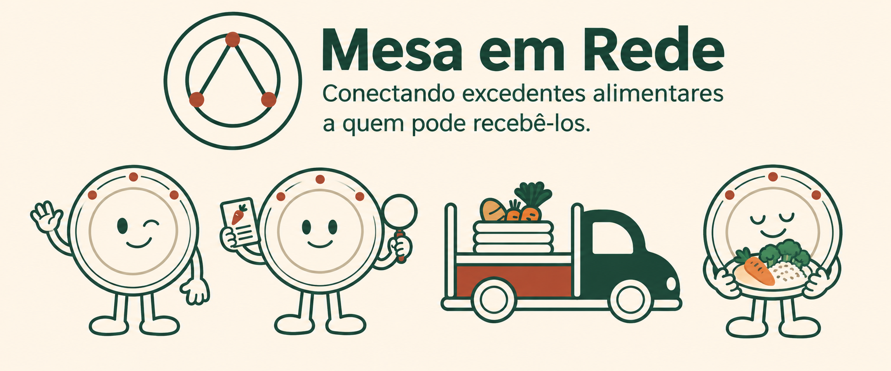

# Mesa em Rede

IA para organizar ofertas de excedentes alimentares, identificar informações
pendentes e apoiar a consulta de organizações receptoras, com revisão humana.

**[Acesse a demonstração online](https://mesa-em-rede.streamlit.app/)**

Projeto de portfólio desenvolvido por **Amanda Carvalho Teixeira**. A demonstração
utiliza ofertas e organizações fictícias; compatibilidade inicial não confirma
uma doação, uma retirada ou o atendimento de pessoas.

## O problema e a proposta

Mensagens informais sobre excedentes podem chegar incompletas ou ambíguas.
Quem faz a triagem precisa organizar alimento, quantidade, bairro e janela de
retirada antes de avaliar possíveis organizações receptoras.

O Mesa em Rede combina um agente Gemini, regras de compatibilidade em Python,
confirmação humana e uma automação n8n para registrar ofertas revisadas no
Google Sheets. Um painel permite explorar os registros importados por CSV.

## Experimente

Na página **Triagem da oferta**, informe uma mensagem fictícia:

```text
Temos 25 unidades de pão na Vila Mariana, para retirada em 16/11/2026, das 9h às 10h.
```

1. Clique em **Analisar mensagem** e confira os dados identificados pelo agente.
2. Complete ou corrija os campos e clique em **Confirmar revisão**.
3. Confira a compatibilidade inicial e os motivos apresentados.
4. Para persistir a oferta fictícia, clique explicitamente em **Registrar oferta**.

Para esse exemplo, a Cozinha Comunitária A — Fictícia atende aos critérios do
cadastro. A data faz parte do caso de demonstração; a consulta não bloqueia datas
passadas nem verifica disponibilidade real. O botão **Usar exemplo** gera outra
mensagem com data relativa ao dia de execução, cujo resultado depende do dia da semana.

Uma mensagem sem quantidade deve gerar uma pergunta, sem consulta de organizações.
É possível completar a revisão diretamente no formulário. Uma alteração nos campos
exige nova confirmação; uma consulta de dados diferentes não pode acompanhar o registro.

No **Painel de indicadores**, escolha **Exemplo fictício** para explorar os gráficos
sem importar um arquivo. Esse conjunto é independente da planilha da aplicação.

## Como o agente funciona

O Gemini solicita ferramentas por **function calling**. A aplicação executa
somente as ferramentas permitidas e devolve seus resultados ao modelo.

| Parte | Responsabilidade |
| --- | --- |
| Agente Gemini | Solicitar extração e, com dados completos, consulta das organizações |
| `extrair_oferta` | Reutilizar a extração estruturada e apontar pendências |
| `consultar_organizacoes` | Aplicar regras determinísticas ao cadastro fictício |
| Código Python | Validar pedidos, limitar etapas e montar o resultado oficial |
| Pessoa responsável | Corrigir os dados, confirmar a revisão e decidir registrar |
| n8n e Google Sheets | Validar o payload e incluir ou atualizar a oferta |

As ferramentas recebem a mensagem ou a oferta mantida pelo Python; o agente
não pode substituir esses dados por argumentos próprios. Há limite de quatro
chamadas de orquestração e quatro pedidos de ferramentas por análise. A extração
reutilizada faz sua própria chamada ao Gemini e possui política de tentativas.
Uma análise pode, portanto, consumir várias chamadas à API.

O agente não tem ferramentas para gravar ofertas, enviar mensagens, agendar
retiradas ou confirmar doações. Seu texto livre não substitui os resultados das
ferramentas. Cada análise começa do zero, sem memória de conversa entre análises.

Na interface, uma prévia de consulta fica separada da revisão confirmada. Ela
é aproveitada após a confirmação humana somente se corresponder à mesma oferta.
Correções podem ser consultadas novamente pelas regras locais, sem nova chamada Gemini.

## Dados e critérios de compatibilidade

| Campo | Formato esperado |
| --- | --- |
| Item | Um alimento por oferta |
| Quantidade | Inteiro positivo, em unidades |
| Bairro | Bairro explicitamente informado |
| Data de retirada | `AAAA-MM-DD` |
| Horário de retirada | `HH:MM-HH:MM`, com fim posterior ao início |

O prompt orienta a manter informações ausentes ou ambíguas como `null`, sem
completar por suposição. Quantidades aproximadas, datas relativas e horários
com apenas um limite exigem conferência. A consulta requer os cinco campos válidos.

Uma organização precisa aceitar o alimento, atender ao bairro, comportar a
quantidade, atender no dia da semana e ter um intervalo de retirada em comum.
Os nomes são comparados sem diferenças de maiúsculas, acentos ou espaços extras;
não há interpretação de sinônimos nem cálculo de proximidade geográfica.

A sobreposição de horários precisa ter duração positiva: um atendimento que
termina às 11h não coincide com uma oferta cuja retirada começa às 11h.
O cadastro local contém três organizações fictícias e não é sincronizado
automaticamente com a aba de organizações da planilha.

## Registro e persistência

O botão **Registrar oferta** fica disponível com revisão completa e confirmada.
Ele envia os dados revisados ao webhook autenticado do n8n. A consulta é opcional:
sem resultado atual, a oferta é registrada como `nao_consultada`.

O workflow busca o `oferta_id`, prepara a inclusão ou atualização e preserva o
instante do primeiro registro. Somente uma resposta HTTP 200 com
`status=registro_ok` e `registrado=true` confirma o sucesso na interface.
Falhas de resultado incerto exigem conferência na planilha antes de reenviar.

O identificador é mantido durante a sessão para atualizar a mesma oferta.
Uma nova análise gera outro ID. Recarregar a página não recupera registros
anteriores na interface; os registros já gravados continuam na planilha.
O n8n confere formato e coerência dos dados recebidos, mas não recalcula a
compatibilidade. A busca e a gravação no Sheets não são uma transação: os testes
de não duplicação foram sequenciais, sem garantia para chamadas concorrentes.

## Painel de indicadores

Importe o CSV da aba **ofertas**: no Sheets, selecione a aba e use **Arquivo →
Fazer download → Valores separados por vírgulas (.csv, página atual)**.

O painel apresenta total de ofertas, resultados de compatibilidade e gráficos
por alimento e bairro. Os filtros usam data do primeiro registro, bairro,
alimento e situação da oferta. Por padrão, ofertas canceladas ficam de fora.

**Taxa de compatibilidade = com compatibilidade ÷ (com + sem compatibilidade).**
Ofertas não consultadas ou com erro são mostradas separadamente e não entram
no denominador. Sem consultas concluídas, a taxa não é calculada.

O painel reflete o arquivo importado e **não se atualiza automaticamente** após
um registro. Exporte e importe novamente para obter novos dados. Os gráficos
contam ofertas, sem somar unidades de alimentos diferentes. IDs duplicados ou
dados inconsistentes bloqueiam o cálculo em vez de serem descartados silenciosamente.
Veja [PAINEL_INDICADORES.md](PAINEL_INDICADORES.md) para formatos e limites.

## Tecnologia

Python, Streamlit, Google Gen AI SDK, Pydantic, n8n Cloud, Google Sheets e Git/GitHub.
A demonstração foi publicada no Streamlit Community Cloud com Python 3.12.

## Execução local no Windows

Na raiz do projeto:

```powershell
py -m venv .venv
.\.venv\Scripts\python.exe -m pip install -r requirements.txt
```

Crie um `.env` local a partir de `.env.example`, se necessário, e configure:

```dotenv
GEMINI_API_KEY="SUA_CHAVE_GEMINI"
GEMINI_MODEL="SEU_MODELO_COM_FUNCTION_CALLING"
N8N_WEBHOOK_URL="SUA_URL_HTTPS_DE_PRODUCAO"
N8N_WEBHOOK_TOKEN="SEU_TOKEN_N8N"
```

Para analisar mensagens, são necessários chave Gemini e modelo compatível.
O registro exige também a URL e o token do seu workflow publicado; o header
de autenticação usado na integração é `X-Mesa-Token`. O painel de exemplo pode
ser explorado sem realizar chamadas Gemini ou n8n.

```powershell
.\.venv\Scripts\python.exe -m streamlit run app.py
```

No Community Cloud, configure os quatro valores como chaves no nível raiz do
campo **Secrets**, em formato TOML, mantendo cada valor entre aspas. Não adicione
uma seção `[secrets]`. O aplicativo também lê esses valores pelas variáveis de
ambiente disponibilizadas pelo Streamlit. Não publique `.env` ou `secrets.toml`.

## Validação

```powershell
.\.venv\Scripts\python.exe -m unittest teste_agente_triagem.py teste_integracao_n8n.py teste_interface_agente.py teste_painel_indicadores.py teste_interface_painel.py -v
```

**58 testes locais aprovados**, com chamadas externas simuladas:

| Grupo | Testes |
| --- | ---: |
| Agente de triagem | 21 |
| Integração n8n | 14 |
| Interface do agente | 6 |
| Importação e indicadores | 12 |
| Interface do painel | 5 |

Os testes abrangem pendências, ferramentas não permitidas, limites de execução,
falhas de conexão, revisão desatualizada, envio explícito, leitura de CSV,
duplicidade de IDs, filtros, denominador da taxa e preservação da revisão na navegação.

Também foram conferidos manualmente:

- Agente com Gemini real para oferta completa e quantidade ausente.
- Correção de 25 para 60 unidades na Vila Mariana, nova consulta sem compatíveis
  e registro da oferta corrigida no Sheets.
- Reenvio sequencial sem duplicação, preservação do primeiro registro e rejeição
  de quantidade zero pelo workflow com HTTP 422.
- Publicação online, análise de uma oferta de 25 unidades com retirada em
  16/11/2026 e confirmação do registro correspondente na planilha.
- Painel local com CSV exportado da demonstração e painel de exemplo na hospedagem.
- Rodapé ilustrado nas páginas do aplicativo, com personagens estáticos.

A avaliação inicial de extração também obteve seis de seis casos sintéticos em
uma execução de `teste_extracao.py`. `teste_organizacoes.py` verificou três
classificações da oferta inicial. Esses scripts são separados da suíte de 58
testes e o teste de extração consome a API. Resultados sintéticos não medem a
precisão em mensagens reais nem garantem respostas idênticas no futuro.

## Estrutura principal

| Arquivo ou pasta | Função |
| --- | --- |
| `app.py` | Interface, revisão humana, registro e navegação |
| `agente_triagem.py` | Orquestração Gemini e controle de ferramentas |
| `extracao.py` | Extração estruturada dos cinco campos |
| `organizacoes.py` | Regras de compatibilidade |
| `integracao_n8n.py` | Payload, autenticação e respostas do registro |
| `painel_indicadores.py` | Importação CSV, filtros e indicadores |
| `prompts/` | Instruções de extração e do agente |
| `data/` | Cadastro, casos sintéticos e exemplo do painel |
| `workflows/registrar-oferta-modelo.json` | Modelo público sem credenciais ou IDs da planilha |
| `AGENTE_TRIAGEM.md` e `INTEGRACAO_AGENTE.md` | Módulo do agente e integração visual |
| `INTEGRACAO_N8N.md` | Configuração e verificação do registro |
| `PAINEL_INDICADORES.md` | Fonte e regras dos indicadores |
| `RODAPE_INTERFACE.md` e `brand/` | Rodapé, identidade visual e personagens |
| `AI_USAGE.md` | Uso de IA, participação humana e limites da avaliação |

## Limites e tratamento dos dados

- A aplicação não verifica condições sanitárias, validade ou transporte.
- A capacidade é por oferta, sem soma de ofertas simultâneas, divisão ou reserva.
- Não há confirmação de aceite, contato com organizações ou comprovação de entrega.
- Não há autenticação de restaurantes ou gestão de acesso por perfil no protótipo.
- Mensagem, dados extraídos e resultados fictícios das ferramentas são transmitidos
  ao Gemini durante a triagem. Use dados fictícios, sem dados de beneficiários.
- O registro envia campos revisados e consulta ao n8n/Sheets; não inclui a mensagem
  original. O CSV do painel não é enviado ao Gemini ou ao n8n.
- O histórico do n8n pode conter headers de autenticação; não publique exportações
  de execuções ou credenciais. O modelo público do workflow foi preparado sem esses dados.
- A disponibilidade depende dos serviços externos, das cotas Gemini e da manutenção
  do workflow n8n. A publicação não elimina esses limites da demonstração.

## Identidade e autoria

O símbolo B2 conecta restaurante, pessoa responsável pela triagem e organização
receptora. Verde escuro `#234539`, creme `#FFF7EB` e terracota `#AD4D35` compõem
a identidade. O Pratinho, o caminhão e o rodapé ilustram o fluxo.

### Pessoas que fazem a rede acontecer


Os personagens representam os papéis da rede proposta: restaurante, triagem,
transporte e organização receptora. O Pratinho aparece nas sacolas como assinatura
visual da marca. A ilustração foi criada com apoio de IA e revisada pela autora.

É uma representação da visão do projeto. A operação de transporte, as parcerias
com organizações reais e o atendimento às famílias são etapas futuras; a demonstração
atual utiliza dados fictícios e não confirma entregas.

**Amanda Carvalho Teixeira** — concepção, decisões de escopo e identidade,
configuração dos serviços e conferência dos resultados, com apoio de ferramentas
de IA documentado em [AI_USAGE.md](AI_USAGE.md).

Próximas evoluções: ampliar a avaliação com mensagens variadas, preparar a
demonstração em vídeo, estudar atualização automática dos indicadores e aperfeiçoar
controle de acesso, recuperação de registros e concorrência na persistência.
