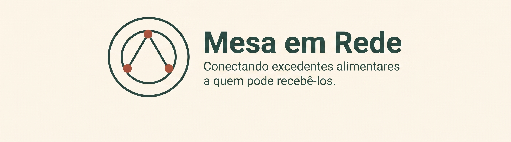

# Mesa em Rede

Projeto de portfólio que usa inteligência artificial para apoiar
a triagem de excedentes alimentares, com revisão humana.

## Problema

Informações sobre excedentes podem chegar em mensagens informais
e incompletas. Organizar esses dados e verificar o que falta exige
trabalho de quem faz a triagem.

## Proposta

Transformar mensagens de restaurantes em ofertas estruturadas,
identificar informações pendentes e sugerir organizações
compatíveis para avaliação pela pessoa responsável.

## Fluxo planejado

1. Receber a mensagem do restaurante.
2. Extrair os dados com IA.
3. Identificar informações ausentes.
4. Permitir revisão e correção.
5. Consultar organizações compatíveis.
6. Registrar a oferta após aprovação humana.

## Status

Em desenvolvimento. A identidade visual foi definida.
A próxima etapa é testar a extração de dados de mensagens.

## Escopo inicial

O protótipo será demonstrado com um restaurante e três
organizações receptoras fictícias.

## Identidade visual

O símbolo B2 representa a conexão entre o restaurante,
a pessoa responsável pela triagem e a organização receptora.

O briefing e os arquivos da marca estão na pasta `brand`.

## Autoria

Amanda Carvalho Teixeira.